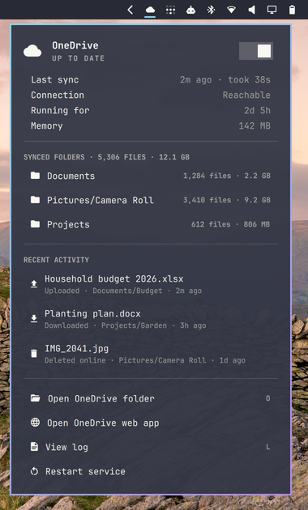

# OneDrive for Omarchy

OneDrive sync status in the [Omarchy](https://omarchy.org) bar, for the
[abraunegg OneDrive client](https://github.com/abraunegg/onedrive), plus an
optional opener that sends OneDrive Office files to Excel, Word and PowerPoint
for the web.



## Bar widget

A cloud icon in the bar that follows the client:

| Icon | Meaning |
|---|---|
| Solid cloud | Up to date, or checking for changes |
| Cloud with arrows | Files are moving (a transfer in the last 90 s) |
| Dimmed cloud | Starting, or the service is off |
| Crossed-out cloud | OneDrive is unreachable |
| Red cloud alert | The last sync had failed items, or the service failed |

Hover for a one-line summary. Click for the panel:

- **Header**: the state, and a switch that starts or stops the `onedrive` service
- **Status**: last sync and how long it took, connection, uptime, memory
- **Failed in last sync**: the items that failed, when any did
- **Synced folders**: each `sync_list` entry with its file count and size; click to open it
- **Recent activity**: the latest uploads, downloads and deletes; click to open the folder
- **Actions**: open the OneDrive folder (`O`), the OneDrive web app, the live log (`L`), restart the service

Right-click the icon opens the OneDrive folder; middle-click refreshes. In the
panel, `R` refreshes and the arrow keys and Enter move through it. IPC:
`omarchy-shell onedrive toggle|refresh|status`.

### Requirements

- Omarchy with the Quickshell shell (`omarchy-shell`)
- [abraunegg/onedrive](https://github.com/abraunegg/onedrive) 2.5 or newer,
  running in monitor mode as the packaged `onedrive` systemd **user** service
  (`systemctl --user enable --now onedrive`). The widget reads the
  `monitor-status.json` file that 2.5 writes.
- `python3`

### Install

```bash
omarchy plugin add https://github.com/jonkristjan/omarchy-onedrive.git --enable
```

`omarchy plugin update jonkristjan.onedrive` pulls new versions;
`omarchy plugin remove jonkristjan.onedrive` removes it.

**Open OneDrive web app** focuses or launches an Omarchy web app for OneDrive
if you made one (Omarchy menu → Install → Web App, with a OneDrive URL such as
`https://onedrive.live.com/`), and otherwise opens `onedrive.live.com` as one.

## Office files in the web apps (optional)

Double-click an `.xlsx`, `.docx` or `.pptx` (and the older and macro formats)
in your OneDrive folder and it opens in Excel, Word or PowerPoint for the web,
ready to edit, instead of a local copy in LibreOffice.

```bash
~/.config/omarchy/plugins/jonkristjan.onedrive/install-office-opener.sh
```

How it works: `onedrive-office-open` checks that the file is inside the sync
folder (following symlinks into it), asks the client for the file's web link
with `onedrive --get-file-link` (read-only, using the client's own sign-in; no
sharing link is created), and opens that link with `omarchy-launch-webapp`. The
first open of a file takes a few seconds and shows a notification; the link is
then cached in `~/.cache/onedrive-office/`, so later opens are immediate.

Files outside OneDrive, not uploaded yet, or opened while offline go to
LibreOffice with a notification saying why. LibreOffice stays under Open With.
If a file was deleted and re-created online under the same name, refresh its
link with `onedrive-office-open --refresh <file>`.

The installer links (not copies) the opener into `~/.local/bin` and
`~/.local/share/applications`, so `omarchy plugin update` updates it too. It
makes the opener the default for the Office types with `xdg-mime` and saves the
defaults you had set. Undo it with:

```bash
~/.config/omarchy/plugins/jonkristjan.onedrive/install-office-opener.sh --uninstall
```

Tested with a personal OneDrive, including folders shared with you. Work or
school accounts (SharePoint links) should work but haven't been tested.

## How it reads state

The widget never talks to the network. `status.py` prints one JSON snapshot
from local state:

| Source | Used for |
|---|---|
| `systemctl --user show onedrive.service` | running, uptime, memory |
| `~/.config/onedrive/monitor-status.json` | client state, reachability, last sync result and failures |
| `journalctl --user -u onedrive` | recent transfers and failed item names |
| `~/.config/onedrive/sync_list`, `sync_dir` in `config` | synced folders, file counts and sizes |
| `~/.local/share/applications/*.desktop` | an Omarchy web app pointing at OneDrive |

The bar polls with `status.py --light` (no journal history or folder walk) every
15 s (the `refreshIntervalSec` setting), and every 3 s while the panel is open or
files are moving. The client reports `syncing` for most of every cycle, so that
alone shows as "Checking for changes" with the normal icon.

File and folder names are shown as plain text. A web app URL is only used if it
is made of plain URL characters, because `omarchy-launch-or-focus` runs its
launch command through `eval`.

## Development

```bash
python3 -m unittest discover -s tests
node tests/model.test.js
omarchy plugin validate .
```

Clone into `~/.config/omarchy/plugins/` to work on it. QML changes usually reload
on save; the shell caches `Model.js` until `omarchy restart shell`.

| File | |
|---|---|
| `manifest.json` | Plugin id, bar-widget entry point, refresh setting |
| `Panel.qml` | The bar icon, the panel, and the service actions |
| `Model.js` | Formatting: states and glyphs, times, sizes, counts |
| `status.py` | The JSON snapshot |
| `office/` | `onedrive-office-open` and its desktop entry |
| `install-office-opener.sh` | Installs or removes the Office opener |

## License

MIT
